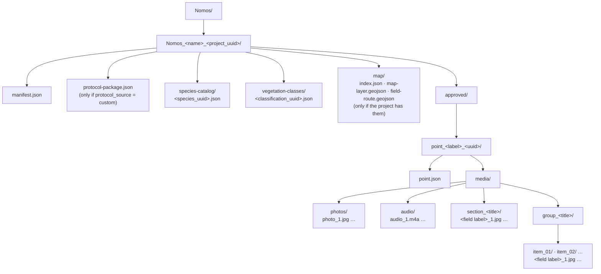

# 12. Backup and collaboration

## Core principle

Exactly one device/account can be the **owner** of a given `project_uuid`
at any time. Ownership is defined by, and only by, having that project
connected to a Google Drive account for backup. Everyone else working on
the same project holds a **collaborator copy** — a fully independent
local project that can never itself become an owner instance of the same
`project_uuid`.

No collaborator ever needs a Google account. Only the owner does, and
only for the backup/restore actions described below.

`projects.collaboration_role` (`'owner' | 'collaborator' | NULL`) is the
single column that decides everything else in this document:

| Value | Meaning |
|---|---|
| `NULL` | A plain local project, never shared in any way. |
| `'owner'` | This device is the authoritative source for this `project_uuid`, connected to a Drive folder (`drive_folder_id`) for backup. |
| `'collaborator'` | This device holds a working copy imported from an owner's configuration package. Can never become `'owner'` for this same `project_uuid` — the UI never offers that transition. |

`db/queries/projects.ts` has exactly two write sites for this column:
`createProject` (sets it once, at row creation — `NULL` by default, or
`'collaborator'` when importing a configuration package) and
`setProjectAsOwner` (the only place that flips it to `'owner'`, called
by both the activation (`runActivation`) and `restoreOwnProjectFromDrive` below).

## Schema

See [05_DATA_MODEL.md](05_DATA_MODEL.md) for the full DDL. Summary of
what this feature added:

| Table | New columns |
|---|---|
| `projects` | `collaboration_role`, `owner_email` (set once, when backup is activated — never changes afterward), `drive_folder_id` |
| `points` | `uuid` (stable cross-device identity), `approval_status` (`NULL \| 'pending' \| 'approved' \| 'rejected'` — `NULL` is the normal state for a point that was never part of any import/collaboration flow), `created_by` (collector code, static since export), `drive_synced_at`, `rejection_reason` |
| `custom_protocols`, `project_species_catalog`, `vegetation_classifications` | `uuid` each |

`owner_email` is a **secondary signal only** — `project_uuid` remains the
one real identity check everywhere. `owner_email` exists purely so a
`project_uuid` collision or drift is easier to notice: `updateManifest`
(below) refuses a write that would silently drop it, and importing a
points package warns (never blocks) if the package's `owner_email`
doesn't match the currently connected account.

## The two packages

| | Configuration package | Points package |
|---|---|---|
| Built by | `core/project-sharing/project-config-package.ts` (`buildProjectConfigPackage`) | `core/project-sharing/export-points.ts` (`buildAndSharePointsPackage`) |
| Applied by | same file, `applyProjectConfigPackage` | `core/project-sharing/import-points.ts` (`importPointsPackage`) |
| Format | single `.json` | `.zip` (`points.json` + `media/<point_uuid>/...`, in the shared media layout) |
| Always produces | a local project with `collaboration_role = 'collaborator'` | new/duplicate points inside an existing local project |
| Carries | `project_uuid`, `protocol_id`/`protocol_source` (+ the custom protocol's schema, if any), the full species catalog, every vegetation classification, `active_vegetation_classification`, `owner_email` | `project_uuid`, `protocol_id`/`protocol_source`, `collector_code`, `owner_email`, one entry per point |

**Media in the points package.** Every media file of a point, wherever it
lives locally (the `points.photos` / `points.audio_notes` columns, or the
`photo_input` / `audio_notes_input` fields stored inside each module's
`data_json`), goes under `media/<point_uuid>/` in the **shared media layout**
(`core/media-layout`, see "One media layout" below):

- `photos/photo_N.<ext>` and `audio/audio_N.<ext>` for the point's own media;
  `points.json` lists these paths relative to `media/<point_uuid>/`
  (`photos/photo_1.jpg`), and `audio_notes[].filename` carries the same kind of
  path.
- `section_<title>/<field label>_<n>.<ext>` for the fields of a section, and
  `group_<title>/item_NN/<field label>_<n>.<ext>` for the media sub-fields of
  every item of a `repeatable_group`. Every URI in the exported `data_json` is
  replaced by a `package-media:<relative path>` marker, so no device path ever
  leaves the sender. A group value is a JSON array of item objects under the
  group id, and a media sub-field of an item holds JSON text exactly like a
  top-level one; the item itself is never removed, only its media references
  are rewritten. Groups are walked one level deep (the builder does not allow a
  group inside a group). The field list comes from the custom protocol's schema
  (`getModuleMediaFields`) and the traversal from `mapModuleMediaUris` /
  `listModuleMediaUris`, both in `core/project-sharing/module-media.ts` and
  shared by every consumer below; shared-module sections (`moduleRef`) carry no
  such fields.

Both packages carry a `format_version` and are rejected outright if that field
is missing or doesn't match, before any other field is even read. The
configuration package is at version 1. The **points package is at version 2**:
version 1 stored media flat (`photo_N`, `audio_note_N`, `modules/<file>`), and
this build no longer reads that layout. A version 1 package is refused with
`OutdatedPackageVersionError` (`core/project-sharing/package-errors.ts`; the
message asks the collaborator to update the app and export again, in the four
languages, `projectView.importPointsOutdated`); any other unknown version
raises `UnsupportedPackageVersionError` ("created by a newer version").

`ProjectConfigPackage.package_role_for_importer` is always the literal
`"collaborator"`; `applyProjectConfigPackage` validates it explicitly and
refuses anything else, and also refuses to re-apply a package onto a
local project whose `collaboration_role` is already `'owner'` — an owner
instance can never be downgraded by an accidental re-import of its own
exported package.

Every uuid embedded in either package (`project_uuid`, the custom
protocol's, every catalog/classification row's) is generated exactly
once, by the single shared helper `core/utils/uuid.ts` (`generateUuid`,
wrapping `expo-crypto`), and never regenerated once set — every
`ensure*Uuid` query function (`ensureProjectUuid`, `ensurePointUuid`,
`ensureCustomProtocolUuid`, `ensureProjectSpeciesUuid`,
`ensureVegetationClassificationUuid`) reads the current value first and
only calls `generateUuid()` if it's still `NULL`. Re-exporting the same
project twice yields byte-identical identity fields both times.

## Role-based actions

Which collaboration action a project shows is decided by
`projects.collaboration_role` alone, never by whether a Google account
happens to be connected. The table lives in one place,
`getProjectActionVisibility(role)`
(`core/project-sharing/action-visibility.ts`), and every screen derives
its buttons and cards from it:

| Action | `NULL` (not shared) | `'collaborator'` | `'owner'` |
|---|---|---|---|
| Collect points | yes | yes | yes |
| Export configuration package | yes | **no** | yes |
| Turn into owner / activate Drive backup | yes | **no** | n/a |
| Export point(s) to the owner | no | yes | no |
| Collector code | n/a | yes | n/a |
| Back up to Drive | no | no | yes |
| Pending approvals | no | no | yes |
| Rejected points | no | no | yes |
| Import points package | no | no | yes |

`undefined` is treated like `NULL`. Importing a points package is not a
row of the original design table; it is the owner-side half of the points
flow, so it follows the owner column.

The consumers are `app/(projects)/project-details/[id].tsx` (FAB actions
and the approval/rejected cards), `app/(survey)/survey-point-details/[id].tsx`
("send to owner"), and the two owner-only screens
(`project-pending-approvals/[id].tsx`, `project-rejected/[id].tsx`), which
also load the project and navigate back if the role is not `'owner'`, so a
collaborator copy cannot reach them by route either. The suite
`core/project-sharing/__tests__/action-visibility.test.ts` checks the
table for all three roles side by side. It tests the function the screens
consume, not a rendered screen tree.

**Collection and collector code are not part of the helper.** Collecting
points is always available, and the collector-code entry in Settings is
global to the device (it is the home base, section "Collaborator-side
actions"), so `getProjectActionVisibility` has no flag for either. The
"Collect points" and "Collector code" rows above are the original design
table, not something the helper enforces.

**The services enforce the role too, not only the screens.** Besides the
checks that already lived in the backup (`backup-service.ts`), the
activation (`activation-service.ts`), the project-data backup
(`project-data-backup.ts`) and re-applying a configuration package
(`project-config-package.ts`), the remaining entry points now refuse a
wrong role themselves, with a typed `ProjectRoleNotAllowedError` (carries
the `action` and the `role`) thrown by `assertProjectActionAllowed`. That
guard reads the same `getProjectActionVisibility` table, so there is no
second copy of the rules:

| Service | Table row | Allowed roles |
|---|---|---|
| `exportProjectConfigPackage` | `exportConfigPackage` | `NULL`, `'owner'` (not `'collaborator'`) |
| `exportPointsPackage` / `exportAllPointsPackage` | `exportPointsToOwner` | `'collaborator'` only |
| `importPointsPackage` | `importPoints` | `'owner'` only |
| `discardMissingMedia` | `backup` | `'owner'` only |

Each check runs before any side effect: before the file picker opens,
before the collector-code prompt and before anything is written or shared.
The screens still hide these actions, so the error only fires if something
calls a service it should not.

**General app features outside the role model.** Exporting a custom
protocol as a JSON file ("Meu Nomos", `app/(projects)/projects.tsx`) and
exporting the species catalog (`components/species/SpeciesManagementModal.tsx`)
are general features of the app, not collaboration actions, so no role
applies to them. Neither file carries a project's identity: the protocol
file holds only the name, theme, description, collection instructions and
schema, and the catalog file only the species list and the export date — no
`project_uuid`, no `owner_email`.

## Collaborator-side actions

A collaborator collects points locally exactly like any other project —
no Google account involved anywhere in this role. Two export actions,
both in `core/project-sharing/export-points.ts`:

- `exportPointsPackage(pointIds)` — a single point ("send to project
  owner").
- `exportAllPointsPackage(projectId)` — every point in the local
  project, same `.zip` shape.

Both resolve to an `ExportPointsReport` (`{ skippedMedia: string[] }`):
a photo or audio file whose source no longer exists on the device is left
out of the zip **and** out of `points.json`, never aborts the export, and
is reported so the screens can warn how many files were left out. Unlike
the Drive backup below, the zip export does not block on missing media.

Both require a local **collector code**: exactly 4 characters, no
uniqueness check against other collaborators (there's no shared registry
of codes in this model — see [Known limitations](#known-limitations)).
`core/local-identity/collector-code.ts` enforces the length;
`components/local-identity/CollectorCodeModal.tsx` is the single shared
modal for setting it, with one home base in Settings
(`app/(tabs)/settings.tsx`) and two trigger points that open it in place
when an export is attempted without a code yet
(`app/(projects)/project-details/[id].tsx`,
`app/(survey)/survey-point-details/[id].tsx`) — the export resumes
automatically once the code is saved. The code is copied onto each point
as a static `created_by` value at export time; changing it afterward
never rewrites points already exported.

## Owner-side: importing points and resolving duplicates

`importPointsPackage` (`core/project-sharing/import-points.ts`) first
checks that the picked file really is a zip: the file picker accepts any
file, and some native unzip libraries crash the whole app (not a rejected
promise) when handed something else, which is what a `.json` did. The copied
file's first four bytes must be a zip signature (`hasZipSignature`,
`zip-signature.ts`; only the header is read, not the whole package); otherwise
it throws `NotAZipFileError` before the native unzip is ever called, deletes
the copy, and the screen says the file is not a points package. It then
validates `project_uuid` and protocol first — either mismatch rejects
the **entire** package, nothing is inserted
(`ProjectMismatchError`). For every point that passes, it checks
`getPointByProjectAndUuid` (`db/queries/points.ts`) — deliberately
**not filtered by `approval_status`**, so a point that's already
`pending`, `approved`, or `rejected` all count as "already here":

- **Not a duplicate:** inserted as `approval_status = 'pending'`.
- **Duplicate:** never auto-inserted. Collected and handed to
  `components/project-sharing/PointDuplicatesModal.tsx` after the import
  finishes, one row per duplicate, with **Substituir** (overwrite the
  local point's data, reset it to `'pending'` for re-review) or
  **Descartar** (keep the local point exactly as it is).

The pass over the duplicates (`core/project-sharing/duplicates-session.ts`)
lives in `project-details/[id].tsx`, not in the modal: the modal receives
the list still undecided and reports each decision. `resolveDuplicate`
removes the decided point (by `point_uuid`) and counts it as replaced or
discarded; the screen then reloads **silently**
(`loadProjectData({ silent: true })`) instead of swapping itself for the
loading spinner, which would unmount the modal and bring it back with the
original list. A second tap on a point whose decision is already running is
ignored (`beginDecision`). When the list is empty the modal closes
(close-then-show) and the consolidated summary is shown. A replaced point
returns to the approval queue as `'pending'`; that is expected.

Media extracted from the `.zip` is copied into
`Paths.document/imported_points_media/<point_uuid>/` (the whole tree, folders
included, so the relative paths in `points.json` and in the markers keep
resolving) **before** any database write references it:
never a path inside the temporary extraction directory, which is deleted
once import finishes (`copyMediaToPersistentDir`; the tree walk is
`transferMediaTree`). The `package-media:`
markers inside module data are then rewritten to those persisted URIs
(`restoreModuleMedia`), both for new points and for "Substituir" on a
duplicate (`resolvePointDuplicate`).

The importer does not trust the names in `points.json`: it only keeps
photo/audio entries whose file really arrived, and counts the rest in
`ImportPointsResult.missingMedia` instead of saving a path that points
nowhere; the screen warns when that count is not zero.

After an import finishes (and after each duplicate is resolved) the
screen refreshes immediately instead of waiting for a navigation:
`refreshAfterImport` (`core/project-sharing/refresh-after-import.ts`)
clears the cached map data and awaits the reload of the project's list
and counters. The same helper runs after importing a configuration
package in `projects.tsx`. Approving or rejecting a point also clears the
map cache, since it changes what the general list shows.

## Local approval queue and rejected points

Two screens, both pure local SQL — no Drive read of any kind:

- `app/(projects)/project-pending-approvals/[id].tsx` — lists
  `approval_status = 'pending'`. **Approve** sets `'approved'` (nothing
  else happens automatically — approval and backup are fully decoupled).
  **Reject** sets `'rejected'` with a **required** reason
  (`components/project-sharing/RejectPointDialog.tsx`, shared with the
  details screen); the point is not deleted. Tapping a card opens the
  point's details (next section) so the owner can look before deciding.
  `updatePointApprovalStatus` returns `false` on a database failure
  (`updatePoint` swallows errors); both screens treat that as a failed
  decision, not a success.
- `app/(projects)/project-rejected/[id].tsx` — lists
  `approval_status = 'rejected'`; tapping a card opens the point's details
  read-only. **Return to queue** (`returnPointToPending`) sets the point back
  to `'pending'` and clears its rejection reason, for a point rejected by
  mistake; it needs no confirmation because it can be rejected again. It
  also has a permanent-delete action
  (`core/points/delete-point-media.ts`). Deleting a point — here and from
  the regular point screen — removes every media file it references:
  the photo/audio columns and the module media of custom protocols,
  top-level and inside `repeatable_group` items. Only files inside the
  app's own storage (`Paths.document` / `Paths.cache`, no `..` segments)
  are deleted; a reference to anything else (a `content://` uri, a gallery
  picture) is left alone. Rejected points are never auto-purged.

### Reviewing a point before approving or rejecting it

`app/(survey)/survey-point-details/[id].tsx` is the same screen used for
any point; its behavior comes from
`getPointDetailsMode(approval_status, role)`
(`core/project-sharing/point-details-mode.ts`), deduced from the point
itself and the project role — never from a route param, so every way of
reaching the screen behaves the same:

| Mode | When | What the screen offers |
|---|---|---|
| `review` | owner opens a `'pending'` point | Read-only data, a hint card, and a FAB with only **Approve** and **Reject**. Edit, edit location, delete, send-to-owner and the "view on map" button are hidden. |
| `readonly` | owner opens a `'rejected'` point | Read-only data and the stored rejection reason. No FAB at all. |
| `normal` | everything else, including any non-owner | The regular actions (edit, edit location, delete, send-to-owner for collaborators). |

Only the owner can ever get `review`/`readonly` (it reuses
`getProjectActionVisibility(role).pendingApprovals`); pending and rejected
points exist only on the owner's device anyway. The map button is hidden
because the map only lists visible points, so it could not show them.

The screen loads the point with `getPoint` (`SELECT * FROM points WHERE
id = ?`), which deliberately does **not** apply `VISIBLE_POINT_CONDITION`
(below); a regression test in `db/queries/__tests__/points-approval.test.ts`
guards that. After approving or rejecting, the screen clears the map cache
(`clearMapData(project.id)`, same as the queue) and goes back; the queue
reloads on focus. If saving the rejection fails, the reject dialog is
closed first and the error alert shown after it (see "Dialogs inside
Portals and Modals").

**Visibility rule.** The project's general point list, map, CSV/GeoJSON/
media exports and landscape-class numbering only ever contain points whose
`approval_status` is `NULL` (collected directly) or `'approved'`. A
`'pending'` point lives only in the approval queue and a `'rejected'` one
only in the rejected area. The condition is the shared constant
`VISIBLE_POINT_CONDITION` in `db/queries/points.ts`, applied by
`getPointsByProject`, `getPointsWithModulesByProject`,
`classifyProjectPoints` and `countPointsByProject`. Three things are
deliberately **not** filtered: the points-package export
(`getPointsWithRawModulesByProject` exports every status), duplicate
detection (`getPointByProjectAndUuid`, section above) and the
`point_number` bookkeeping in `createPoint`/`deletePoint`, which must see
every row to keep numbers unique. As a consequence, pending points consume
numbers, so the visible list can show gaps until they are approved.

## Backup to Drive

Available only when `collaboration_role = 'owner'` and a Google account
is connected. Two steps:

**1. Activation** — before it runs, `project-details/[id].tsx` asks for
confirmation: *"This project will be linked to the account <email> and
this cannot be changed later."* with **Cancel**, **Use another account**
and **Continue**, stacked one per row at full width (`actionsLayout:
"stacked"` on `showDialog`: the `role: "primary"` action first, the
`role: "cancel"` one last), with the email made breakable
(`makeEmailBreakable`, `core/ui/dialog-layout.ts`) so a long address wraps
inside the dialog. The reason is that `owner_email` is written once (into
the manifest and `projects.owner_email`) and never changes
(`updateManifest` refuses to rewrite it), so the person must see which
account the project is binding to. **Use another account** signs the
current account out and reopens the connection modal with the account
chooser forced (see "Google account and shared modals"); once the new
account connects, the confirmation is shown again with the new email.
Only **Continue** starts the activation, and it runs in the **same backup
session** as the other backups (see "The backup session and modal"): the
pre-flight first (no connection, no modal), then the modal that holds the person
with progress ("Creating the folders on Drive...", then protocol, classifications,
catalog, manifest) and **Cancel**, and a result that says "Backup activated" or
why it could not be activated. It no longer uses the banner at the top of the
screen, so leaving the screen is not possible while it runs.

`runActivation(projectId, context)` (`core/drive-sync/activation-service.ts`)
refuses a project whose `collaboration_role` is already set to anything
(`InvalidCollaborationRoleError`) and a missing account
(`GoogleAccountRequiredError`). It reuses `buildProjectConfigPackage` (same
uuid-guaranteeing logic as the collaborator package), creates the folders
(`ensureFolder`) and sends every item through `backupProjectData`, the same
sender as the on-demand project-data backup, with the manifest **created**
(`createManifest`) and last. **The project is marked as owner
(`setProjectAsOwner`) only when everything was sent**, and only then is the
snapshot recorded. A cancelled, interrupted or failed activation leaves the
project local, and trying again reuses the folders and updates the files by name
instead of creating second copies (the former `uploadJsonFile`-always version
would have duplicated them). A half-finished activation leaves a partial
`Nomos_<name>_<uuid>` folder in Drive, without a manifest, until it is completed;
the restore list shows it by its folder name.

**2. Ongoing backup of the owner's points** — `backupPoint`/
`backupAllPendingPoints` (`core/drive-sync/backup-service.ts`), run only on
demand through the backup session (see "On-demand backup" below). What is
pending is decided by change detection against the local snapshot, **not** by
`drive_synced_at`: a point is pending when it is new or when anything it would
send changed since it was last sent. Eligible points are those with
`approval_status` `NULL` (the owner's own field work, collected directly)
or `'approved'` — the same set as `VISIBLE_POINT_CONDITION` —
(`getBackupCandidatePointsByProject`, `isBackupEligibleStatus`); `'pending'`
and `'rejected'` points never are. `backupPoint` enforces the same rule on
its own (the owner-only check was already there).
`backupAllPendingPoints(projectId, onProgress?, options?)` works on the list it
is given (`options.points`, captured when the run started), calls
`onProgress({ current, total })` (1-based, fixed `total`) before each point and
`options.onPointDone` after each one, and stops between points (and between a
point's uploads) when `options.shouldCancel()` turns true. A cancelled point is
neither sent nor failed: it stays pending. A failure in one point never stops
the batch: besides the failures `backupPoint` returns, an **unexpected
exception** thrown while backing up a point (a database error, say) is caught
and recorded as that point's entry in `BackupSummary.failed`, and the loop
continues.
Media is part of the collection, so a point is **all-or-nothing**:

- The point's data and **all** of its media must reach Drive: point-level
  photos and audio (`media/photos/photo_N.<ext>`, `media/audio/audio_N.<ext>`)
  and, for custom protocols, the `photo_input` / `audio_notes_input` files
  that live inside module data, including those inside `repeatable_group`
  items (see "Drive folder structure" for where each one goes). Every media
  is referenced from `point.json` by its **exact path relative to the point's
  folder**, with forward slashes — in `photos`, in `audio_notes[].filename`
  and, for module data, in `package-media:<relative path>` markers — never a
  `file://` uri or a device path. The collaborators' zip is a different
  format and is not affected.
- If any file is missing locally or fails to upload, the whole point
  fails: its JSON on Drive is **not** written (an existing Drive JSON is
  never rewritten with fewer media than the point has), and
  `drive_synced_at` stays `NULL`. All failures are collected and returned
  together in `BackupResult.error`.
- Folders and files are never duplicated. `approved/` is listed **once per
  batch** (paginated) and the point's folder is found by its `_<uuid>`
  suffix; the folder ids met on the way are cached for the batch
  (`drive-folder-cache.ts`). Inside a folder that already existed (a retry
  or a re-backup) every subfolder and file is looked up by exact name and
  updated in place. Inside a folder created **in this same call** there is
  nothing to find, so subfolders and files are created directly — which is
  also what keeps a first backup cheap. The per-point backup action is
  disabled only while the point is up to date: it is enabled again when the
  point changed after its backup (`project-details/[id].tsx`).
- `point.json` is written **last**. A failure of any folder or media leaves
  the point without `point.json` and without `drive_synced_at`; the folders
  already created stay, and the next attempt reuses them.

### Discarding media that no longer exists on the device

A photo or audio file can disappear from the device (the OS cleared the
cache, the person deleted it). Because backup is all-or-nothing, that
point would otherwise never be backed up. `BackupResult.missingMediaCount`
counts the failed items that are simply gone from the device (as opposed
to upload failures such as no connection, which are not counted), and each
`BackupSummary.failed[]` entry carries `pointId` and `missingMediaCount`.

When that count is above zero, `project-details/[id].tsx` offers
**"Descartar mídias não encontradas"** — after the "back up all" summary,
or after a single-point backup fails:

1. A destructive confirmation states how many files from how many points
   no longer exist and that only the references will be removed.
2. On confirm, `discardMissingMedia(pointId)`
   (`core/points/discard-missing-media.ts`) runs for each affected point.
   It removes the entries whose file does not exist from `points.photos`,
   `points.audio_notes` and, for custom protocols, from the media fields
   inside module data, group items included (keeping each entry's shape
   and the module's `schema_version`; a group item whose media was
   discarded stays, only the reference goes away).
3. The backup is retried, now carrying only the media that exists.

It only ever removes references: files that exist are never touched, a
point with nothing missing is not written at all, and `drive_synced_at` is
left alone (the retried backup sets it). The action cannot be undone.

## Drive folder structure

All the fixed names live in one file, `core/drive-sync/drive-layout.ts`
(lowercase English, like `species-catalog` or `manifest.json`):

- **`point_<label>_<uuid>`** — one folder per point. The **uuid is the
  identity**; the label is only there for the person browsing Drive: the
  collector code and the point number (`ABCD-3`), or just the number
  (`point_3_<uuid>`) when the point has no collector code. A placeholder such
  as `?` is never written. The folder is **not** named after the landscape's
  generated name (it changes when the point is edited).
- **`point.json`** — the point's data (`PointPackageEntry`), with the media
  referenced by relative path, e.g. `media/photos/photo_1.jpg` or
  `package-media:media/group_Amostras/item_01/Foto_1.jpg`.
- **`media/photos/`**, **`media/audio/`** — the point's own photos and audio
  notes.
- **`media/section_<title>/`** — media fields of a section of a custom
  protocol; **`media/group_<title>/item_NN/`** — media fields of one item of
  a repeatable group. `<title>` is the section title or the group's label in
  the protocol, untranslated; files are named `<field label>_<n>.<ext>`.
- Subfolders exist **only when they hold at least one file**.

Every name that comes from data is sanitized by `drive-layout.ts`: `/ \ : * ?
" < > |` and control characters are removed, repeated spaces collapse, and
titles and file base names are cut at 40 characters so full paths stay well
under Windows' 260-character limit when the tree is downloaded. Two siblings
that would end up with the same name are told apart by appending the field or
group key and then a counter, because Drive accepts repeated names and a
lookup by name would be ambiguous. The Drive paths come from the shared
allocator described next; `core/drive-sync/drive-media-paths.ts` keeps only the
`package-media:` marker helpers and `splitRelativePath`.

#### One media layout

`core/media-layout` is the single place that decides where a media file goes,
as a path **relative to a media root**. It is pure (no database, no file
system): `names.ts` (fixed folder names, `sanitizeName`, `uniqueName`),
`labels.ts` (section titles and field labels read from the protocol schema) and
`allocator.ts` (`createMediaPathAllocator`). Three outputs use it, each with its
own root, and get the same tree under it:

| Output | Root | Purpose |
|---|---|---|
| "Exportar mídia" zip (`core/export/file-writer.ts`) | `Point_<n>/` | browsing, by people |
| Collaborator points package | `media/<point_uuid>/` | moving points between devices |
| Drive backup | `<point folder>/media/` | safe copy, restore |

The tree is `photos/`, `audio/`, `section_<title>/`, `group_<title>/item_NN/`.
Only the "Exportar mídia" output asks for the `dated` audio naming
(`audio_note_<n>_<YYYY-MM-DD_HH-mm>.<ext>`, and the same time tag on audio inside
sections and groups): there people browse the files and the recording time is
part of the name; the package and the backup keep the time in their own data.
A path is only handed out for a file that exists, so a folder is never empty.
The allocator is deterministic for a given order of media, which is what makes a
re-backup reuse the folders of the first attempt. The Drive layout did not
change with this unification, so existing backups restore as before.

#### Field route and map layer (`map/`)

A project has **one mapping layer and one field route** (the columns
`projects.geojson_layer` and `projects.geojson_field_route`). Each column holds
the absolute URI of a file the app copied into the documents folder when the
person attached it, so the value is specific to the device and is never sent:
the backup sends the file's **content**, as raw GeoJSON (it opens in QGIS), and
a restore writes a *new* file and stores the new URI.

- `map/map-layer.geojson` and `map/field-route.geojson`: the two files, each
  present only when the project has it.
- `map/index.json` (`core/drive-sync/map-index.ts`): `{ format_version: 1,
  layer: { file } | null, route: { file } | null }`. The app has one role per
  file and no other metadata (name, order, colour), so the index exists to carry
  a `format_version` a restore can refuse, and to tell "this project has no
  route" from "the file is missing". Only the two fixed file names are valid; an
  index naming anything else is refused, so a hand-edited index cannot make a
  restore read another file of the folder.
- Two items of the project-data scope (`maplayer`, `fieldroute`, group `map`,
  sent before the manifest). Their fingerprint is the **content** of the file
  (`collectMapFiles`, `backup-collectors.ts`), so attaching, replacing or editing
  one makes the project-data backup pending; removing one is a pending removal
  too (the key leaves the snapshot). A column that is empty, or whose file is
  gone or no longer a `FeatureCollection`, simply has no item.
- Sending (`sendMapItem`, `project-data-backup.ts`): the file is looked up by
  name first and updated, never duplicated; **the file goes up before the index
  is updated**, so the index never names a file that is not there. The index is
  read-modify-write, like the manifest: an index with a `format_version` this
  build does not know is never overwritten (the item fails). Removing a route or
  layer only clears its slot; nothing is deleted on Drive (the same rule as every
  other deletion). A file over 1 MB is sent with the transfer timeout
  (`DRIVE_TRANSFER_TIMEOUT_MS`) instead of the metadata one, and one over 5 MB
  fails with its own reason (`driveBackup.reason.mapTooLarge`) instead of going up
  without a warning. The activation sends them too.
- The manifest is untouched by all of this: it still goes only through
  `updateManifest`, and the map items never write `project_uuid`, `owner_email`
  or `format_version`.
- The configuration package (the collaborator's copy of the project) does **not**
  carry the route or the layer; only the owner's Drive backup does.

`manifest.json` (`ProjectManifest`, `project-drive-service.ts`) holds
`format_version`, `project_uuid`, `project_name`, `project_description`,
`protocol_id`, `protocol_source`, `owner_email`, and `active_vegetation_classification`
(`{ type: 'standard' }` or `{ type: 'custom', custom_classification_uuid }`).
It is never reconstructed from local state — every writer goes through
`updateManifest(driveFolderId, updater)`, which reads the current file,
applies the updater, and refuses to write (throws, nothing is sent) if
the result would change `project_uuid`, drop a non-null `owner_email`,
or change `format_version`. This read-modify-write discipline is what
keeps two independent writers (activation, and the on-demand project-data
backup) from ever clobbering each other's fields. The project's name and
description are part of the manifest (and of the configuration package, and
are restored from either), so editing either one makes the project-data
backup pending.

## On-demand backup, scopes and change detection

**Nothing is sent to Drive unless the person asks.** The former silent sync
(`catalog-sync-service.ts`, called after every species or classification save
in 10 places) is gone: saving locally never touches the network, which also
means fewer Google API calls. A guard test
(`core/drive-sync/__tests__/no-automatic-drive-writes.test.ts`) fails if a
screen, component, module or hook imports the Drive client, or if anything but
`google-auth-service.ts` calls `getTokens`. The only Drive writes are:
activating the backup, and the two backups below, started from the project
screen.

**Two scopes, one mechanism.** Both use the same single-flight lock, the same
modal and send only what is pending:

| Scope | Items (snapshot key) | Sent by |
|---|---|---|
| `points` | one per eligible point (`point:<id>`): its data, its modules' data and the identity of its media | `runPointsBackup` → `backupAllPendingPoints` |
| `project` | `protocol` (custom protocols only), `vegclass:<uuid>`, `species:<uuid>`, `maplayer` and `fieldroute` (when the project has them), `manifest` | `runProjectDataBackup` → `backupProjectData` |

`backupProjectData` sends the items in that order, so the manifest goes last
and is **held back** when any classification failed to upload (the manifest is
never pointed at a file that is not on Drive). Files are listed once per
folder per run and updated in place by name, never duplicated; the manifest is
only written through `updateManifest`, keeping its identity guards. Editing an
existing species or classification now propagates (the old sync only ever
added missing files).

**Change detection** (`core/drive-sync/change-detection.ts`, pure). Each item
has a fingerprint (a 53-bit hash of canonical JSON, cheap and synchronous;
not a security hash). The collectors (`backup-collectors.ts`,
`backup-items.ts`) build the items from SQLite and the file system, locally and
offline. Two rules matter: `points.updated_at` and `drive_synced_at` are **not**
part of a point's fingerprint (the backup itself rewrites both, which would
flip every point back to pending), and media is identified by path, size and
modification time (`File.info()`), never by reading the bytes.

The **snapshot** is local to the device and never uploaded: tables
`drive_backup_items (project_id, scope, item_key, fingerprint, synced_at)` and
`drive_backup_scope (project_id, scope, last_backup_at)`, both with
`ON DELETE CASCADE` on the project (see the data model). The fingerprint of an
item is written **as each item succeeds**, using the fingerprint captured when
the run started; so a cancelled or partial backup leaves exactly the unsent
items pending, and a point edited during the run stays pending. Items that
disappeared locally (deleted, or no longer eligible) count as a change; the
backup only drops them from the snapshot and **does not delete anything on
Drive**, so the Drive copy remains a safety net against accidental deletion.
Activating the backup records the project data as sent, and a restore from
Drive records both scopes as up to date (`seedBackupSnapshots`).

**Status** (`backup-status-service.ts`, `useBackupStatus(projectId, scope,
enabled)`): `never` (no backup of the scope ever ran, work pending), `pending`,
`upToDate` (with the last backup time) or `unverifiable`. Unverifiable means an
error reading the project or the snapshot, or an up-to-date project whose
connected Google account is not the owner's (the backup could not run); it is
never reported as a false "up to date". It is computed in small async steps
when the screen gains focus and when a backup ends, so opening the screen does
not block. The project screen shows an owner-only card
(`DriveBackupCard`) with one row per scope: the status text ("Up to date with
Drive (date)" or "N item(s) pending") and a button that is enabled unless the
scope is verifiably up to date.

## The backup session and modal

State lives in a module store, not in a screen
(`core/drive-sync/backup-session.ts`, read through `hooks/use-backup-session.ts`),
so it survives navigation. Every start goes through the **pre-flight** (below)
via `startBackupWithPreflight({ scope, projectId, run, preflight, onBlocked,
onFinished, onDismissed })`, which returns `already-running` when a backup of
**any** scope or project is checking, running, or has a result not yet
dismissed; a plain module variable guards re-entry, so two taps in the same
frame cannot both start. `BackupModal` (mounted once in `app/_layout.tsx`)
renders the session and holds the person until the end:

- `checking`: the pre-flight is running. The lock is held, nothing is shown.
- `running`: stage and "N of M", a progress bar, the activity log (below),
  "Keep the app open until it finishes" and **Cancel**. Android Back and a tap
  outside open the cancel confirmation instead of closing.
- `confirmingCancel` → `cancelling` → result `cancelled`: the run stops between
  items; what was sent stays sent, the rest stays pending.
- `finished`: stays until **OK** (single action: `ModalActions` places a lone
  button in the right column). The view rules are the pure reducer
  `core/ui/backup-modal-state.ts`.

### Progress bar and activity log

One modal serves every backup: the points backup, the project-details backup
(`runProjectDataBackup`), the single-point button and the activation all go
through `launchBackup` and the same global `BackupModal`, so there is no second
progress dialog to keep in step. Its footer is the shared `ModalActions`
(rounded rectangular buttons, the standard spacing above and below).

**The bar follows the item in progress, not the ones already done.** Runners
report `context.report(stage, k, N)` with `k` the 1-based position of the item now
going up, so the first of 4 shows 25 % while it uploads instead of 0 %.
`core/ui/progress.ts`:

- `getProgressFraction({ current, total }, finished)` is `null` (indeterminate)
  before the first item starts or while the total is unknown, `k / N` during the
  run, `1` at the end, and never divides by zero (`total` 0). A failed item or a
  cancel is not an input, so neither makes the bar jump.
- `advanceProgress` keeps the position from going backwards within one run
  (the session applies it on every report); a different total is a new list and
  is taken as it comes.

**The log** (`core/ui/activity-log.ts`, `components/drive-sync/BackupActivityLog.tsx`)
is a short list of typed events: `item-start`, an optional `media` ("photo 2 of
5"; the counts are per kind, over the point's own and its modules' media),
`item-done` and `item-failed`. A cancelled item logs only its start. Items are
named by `failureName`, the function the failure list uses, so a point is
"Ponto 2" and a species its own name in both places, never an id. The runners
emit through `context.activity`; `backupAllPendingPoints` takes an `onEvent`
option and `backupPoint` an `onMedia` option, `backupProjectData` emits for each
item it sends. `appendActivity` keeps the newest 50 events and `visibleActivity`
returns the last 5 for the screen. The component has small type, one line per
event and a **fixed height** of 5 lines, newest at the bottom, so the dialog
never changes size while it fills; it is a polite live region
(`accessibilityLiveRegion="polite"`). Texts are `driveBackup.log.*` in the four
languages.

**Update rate.** The session state is current at once, but subscribers are told
about progress and log changes at most every 100 ms
(`PROGRESS_NOTIFY_INTERVAL_MS`); a change of phase (start, cancel request, result)
is announced immediately. Screens that only need to know whether a backup runs
read `useBackupPhase()`, a string, so the project screen does not re-render on
every report; only `BackupModal` reads the full state.

### Pre-flight: a backup that cannot reach Drive never starts

`core/drive-sync/backup-preflight.ts` (wired in `backup-runners.ts`,
`preflightBackup`) runs while the lock is held, before the progress modal opens,
for both scopes, the single-point backup and the export warning's "Fazer
backup":

1. **Connection**: `isOnline()` (NetInfo, `core/net/connectivity.ts`). Offline
   fails at once, without touching the network (airplane mode).
2. **Token**: `getDriveAccessToken()`; a network failure there is `offline`, any
   other is `auth`.
3. **One light Drive request** (`findChildByName` on the project folder's
   `manifest.json`) with a 6 s limit that really aborts the request.

The result is `null | "offline" | "unreachable" | "auth"`. On a failure the lock
is **always** released (also if the pre-flight throws), `run` is never called,
no item, snapshot or pending state is touched, the progress modal does not open,
and a plain dialog (single OK) says why: "No connection / Connect to the
internet and try again. Nothing was sent." (or the `unreachable` / `auth`
equivalents). When the start came from the export warning, OK brings the warning
back, so "Export anyway" is still there.

### Result states

One pure function decides how a run ended (`classifyRun`, `backup-results.ts`),
for both scopes and the single-point backup:

| Situation | Outcome | Title |
|---|---|---|
| every pending item was sent | `completed` | Backup complete (the only success title) |
| at least one sent, at least one failed for its own reason | `incomplete` | Backup incomplete |
| no network mid-run, at least one sent | `interrupted` | Backup interrupted |
| no network, nothing sent | `error` (reason `offline`) | No connection (same text as the pre-flight) |
| the person cancelled | `cancelled` | Backup cancelled |
| nothing sent for another reason (all items failed, token) | `error` | The backup could not be completed + the predominant reason |

The first network error (`isConnectionError`: no network at all) stops the
remaining items at once; they count as not attempted, not as failures. A
timeout is **not** a lost connection: on a slow link one large photo can time
out while the next point still goes through, so it stays a failure of its own
item. "0 sent, N not sent" therefore never appears under a complete or
incomplete title (tested as an invariant). The body shows only the counts and,
for an incomplete run, the reason most items share; the item-by-item list (name,
reason in plain words, then the technical text) is under "Show details".

**Naming the failed item.** A point is named exactly as the project's point
list names it ("Ponto 2": `formatPointName`, `core/points/point-label.ts`, used
by both), with its coordinates (four decimals) only under "Show details" to tell
points apart. `getPointDisplayLabel` (collector code plus number) no longer has a
`?` placeholder: the owner's own points have no collector code (it is only
assigned when a collaborator exports), and that is what used to print "?-2". The
other items carry their own name (species, classification, protocol, project);
one without a name gets a fallback by kind ("Unnamed species", ...). Because
`core/` has no translations, a `BackupItem`/`BackupFailure` carries a `kind` and,
for points, `{ number, lat, lon }`; `backup-labels.ts` words them with `t()`.
Neither a uuid, an internal id nor a `?` is ever shown.

Raw errors never reach the person as the reason: `backup-errors.ts` maps
timeouts, offline, authorization, quota, missing folder, Drive 5xx and
missing media to translated reasons (`driveBackup.reason.*`). After OK, the
screen reloads and offers to discard media that no longer exists on the device
(the earlier flow, now started from `onDismissed`). The per-point cloud button
uses the same lock, pre-flight and modal.

## Export warning

Exporting the configuration package (the project data) asks the owner of a
Drive-linked project first, when the project data is not up to date or could
not be checked (`decideExportGate`, `core/project-sharing/export-gate.ts`,
pure). A collaborator, a plain local project, or an owner without a Drive link
export straight away. The dialog (`ExportWarningDialog`) offers **Export
anyway** (outline) and **Back up** (solid); closing it cancels. **Back up**
runs the project-data backup and the export continues by itself only when it
ends `completed`. With no connection (`core/net/connectivity.ts`, NetInfo)
**Back up** is disabled with a note and **Export anyway** stays available; if the connection is lost only after tapping it, the pre-flight dialog's OK returns to this warning. The
package holds no points, so only the `project` scope is checked.

## Restoring the owner's own project on another device

The only remaining scenario where the app reads from Drive proactively,
framed as "your own backup," never as "shared projects." In "Meu
Nomos" (`app/(projects)/projects.tsx`), "Restaurar Meus Projetos do
Drive" lists the signed-in account's own Nomos folders
(`listOwnNomosProjectFolders`,
`core/drive-sync/project-drive-service.ts`) that don't already have a
local project linked (`getUsedDriveFolderIds`), via
`components/drive-sync/RestoreProjectsModal.tsx`.

`restoreOwnProjectFromDrive(driveFolderId)`
(`core/drive-sync/restore-service.ts`) rebuilds the project entirely
from what's on Drive — no dependency on any local leftover — recreating
it with `collaboration_role = 'owner'`, every species/classification
with its uuid preserved verbatim (never regenerated), and every point
under `approved/` with `approval_status = 'approved'` fixed (pending and
rejected points are never uploaded in the first place, so there's
nothing else to pull).

A project catalog never holds two species with the same scientific name
(`createProjectSpecies`, `db/queries/project-species.ts`, compares
`speciesNameKey`: case, accents and repeated spaces ignored, the whole name
compared - authorship is not stripped). On restore, and when importing a
configuration package, a species whose name already exists under **another
uuid** keeps the local record and the received one is ignored; the operation
does not fail. A real failure inserting a species, by contrast, is not
swallowed: the restore is undone like any other failure.

The restore is **always complete and all-or-nothing**; there is no "data
only" mode, because media is part of the collection and a point restored
without it would be re-uploaded without it by the next backup:

- `map/` is read before the points (cheap to fail early): no folder, no index,
  or an empty slot means the project had none; an index slot whose file is gone
  from Drive restores that slot as empty. An index with an unknown
  `format_version`, or a file that is not a GeoJSON `FeatureCollection` (the same
  rule `core/utils/geojson.ts` applies when the person attaches a file), raises
  `MapRestoreError` (`driveRestore.errorMapData`, four languages) and the whole
  restore is undone, files written included. Each file is rewritten as a new
  `layer_<time>.geojson` / `route_<time>.geojson` in the documents folder and
  `updateProjectGeoJSON` stores the new URI.
- `approved/` is listed (paginated) and only folders named
  `point_<label>_<uuid>` are read: anything else in it is ignored. Only the
  `_<uuid>` suffix matters, so editing the label part of a folder name does
  not stop a restore. A folder without `point.json` (a backup that never
  finished) is skipped, and so is one whose `point.json` carries another uuid.
- Points are restored **oldest first** (`created_at` in `point.json`, ties by
  folder name). Local point numbers are handed out in insertion order and
  Drive lists children in no defined order, so this keeps the numbering the
  same on every restore.
- Every photo and audio note a point lists, including custom-protocol
  module media (`package-media:` markers swapped for local files), is
  downloaded into `Paths.document/imported_points_media/<point_uuid>/` —
  the same persistent directory convention `import-points.ts` uses, never
  a temporary one. Each file is found by **following the path written in
  `point.json`**, folder by folder (listings are cached per folder); names
  are never recomputed. Local file names are safe ASCII with a counter.
- A folder or file of that path missing from Drive (for instance something
  renamed or moved inside `media/`), or a failed download,
  raises `MediaRestoreError` (`core/drive-sync/restore-errors.ts`). Any
  failure after the local project was created — media or otherwise —
  deletes the partial project (`deleteProject`) and the media already
  downloaded, then rethrows. The person sees
  `driveRestore.errorMediaDownload` ("nothing was restored, try again")
  and can simply retry.
- Restored points get the Drive file's timestamp as `drive_synced_at`, and both backup scopes start up to date
  (`createPoint` persists it), so they are not offered for backup again.
- `RestoreProjectsModal` asks for a single confirmation (Cancel /
  Restore); it no longer offers two modes. While restoring, the button
  shows a spinner and the modal cannot be dismissed.
- On **success** the modal closes itself (including its confirmation
  dialog) and waits for its exit animation before calling `onRestored`, so
  the summary alert is not stacked behind it (see "Dialogs inside Portals
  and Modals"); on **error** nothing closes and the message stays visible
  in the dialog.

A defensive `Set` of seen `point_uuid`s also protects against two folders in
`approved/` claiming the same point, which would produce two local rows for the same point
(`points` has a partial unique index on `(project_id, uuid)` — see
[05_DATA_MODEL.md](05_DATA_MODEL.md) — that would otherwise reject the
second insert outright).

`RestoreResult`'s fields, each surfaced to the user in the single
summary alert built by `projects.tsx`'s `handleProjectRestored` (the
warnings are merged into that one alert, because showing several in a row
would replace one another):

| Field | Meaning |
|---|---|
| `imported` | Points actually created locally. |
| `mediaDownloaded` | Number of media files downloaded. A failed download aborts and undoes the restore, so there is no failure count. |
| `ownerEmailWarning` | The manifest's `owner_email` differs from the connected account — informational only, never blocks. |
| `activeClassificationWarning` | The manifest pointed at a custom classification whose file wasn't found among the downloaded ones — the project was restored as `'standard'` instead, and the owner is told to double-check, rather than this happening silently. |
| `duplicatesSkipped` | Stray duplicate point files found and ignored during this restore. |

## Google account and shared modals

Required **only** for the three owner actions above (activate backup,
back up, restore) — never for viewing a collaborator project, exporting
points, reviewing the local approval queue, or the rejected-points area.
No screen gates itself entirely behind a connected account; each
owner-only handler checks individually.

`components/google-account/GoogleConnectionModal.tsx` is the single
shared connection UI, home base in Settings, also opened in place by
`projects.tsx` and `project-details/[id].tsx` whenever one of those
three actions is attempted without a connected account — the pending
action (`pendingDriveIntent`, local state in each screen) resumes
automatically once the modal's `onConnected` fires.
Every `useGoogleAccount()` instance keeps its own state (the modal has one,
and so does the Settings tab, which stays mounted), so a caller that shows
the connection status must re-read it: the modal calls `onAccountChange`
after each connect or disconnect, and Settings also calls the hook's
`refresh()` every time the screen gains focus.
`core/google-auth/google-auth-service.ts` wraps
`@react-native-google-signin/google-signin` behind a lazy `require()`
(never a static top-level import) so the module doesn't crash an
environment without the native binding (Expo Go); `getCurrentGoogleAccount()`
never throws, since Settings calls it eagerly on mount.

**Account chooser.** On Android, `GoogleSignin.signIn()` has no "force the
chooser" option: it returns the last signed-in (or previously consented)
account without any UI, even after the app's data was cleared, because the
Drive consent lives in Google Play Services, not in the app.
`signInWithGoogle({ forceAccountChooser: true })` therefore calls
`signOut()` first (clears the cached account, keeps the consent;
`revokeAccess()` would drop the consent too), and the modal's
`forceAccountChooser` prop is what "Use another account" sets. On a device
with a single Google account Android may still skip the chooser.

Each `useGoogleAccount()` instance keeps its own state, so the modal
re-reads the account (`refresh()`) whenever it opens, and `onConnected` is
fired from the sign-in's own result — never from an account-state effect —
so opening the modal on an already-connected account cannot trigger it.
The modal cannot be dismissed while a sign-in is in flight.

## Network timeouts

React Native's Android OkHttp client runs with connect/read/write timeouts of
`0` (no limit), so every Drive call has its own:

- `core/drive-sync/drive-api-client.ts` sends every request through one
  helper (`driveRequest`) built on `withTimeout`
  (`core/net/network-timeout.ts`): an `AbortController` whose limit covers
  the whole exchange, body read included. Two named levels:
  `DRIVE_METADATA_TIMEOUT_MS` (30 s: folder lookups, listings, point and
  manifest JSON) and `DRIVE_TRANSFER_TIMEOUT_MS` (180 s: photo/audio upload
  and download; media is 1-10 MB, base64 uploads ~33% larger, so a slow
  ~100 kB/s link needs up to ~140 s). A timeout throws `DriveTimeoutError`
  (`core/drive-sync/drive-errors.ts`, a `NetworkTimeoutError`).
- `File.downloadFileAsync` cannot be aborted (see Known limitations), so it
  is raced against the same timer.
- `core/google-auth/google-auth-service.ts`: `getTokens()`, `signOut()` and
  the Play Services check use `GOOGLE_AUTH_TIMEOUT_MS` (30 s). The
  interactive `signIn()` has its own, longer `GOOGLE_SIGN_IN_TIMEOUT_MS`
  (120 s) because the person picks an account and may type a password.

**One token call at a time.** The Google Sign-In library admits one
`getTokens()` at a time; a second call while the first is pending overwrites
its promise (the "PGMN-2: previous promise did not settle" warning). Every
Drive request asks for a token, and the old silent syncs ran alongside a
backup, so calls overlapped. `getDriveAccessToken` now shares the call in
flight between all callers, tied to the native promise (not to a caller's
timeout), so a call that outlived its timeout is joined rather than stacked; a
call pending for twice the timeout is treated as lost and a new one may start.

A timeout is an ordinary failure for the flows that already handle failures:
`backupPoint` fails the point without writing its JSON or setting
`drive_synced_at`, and flags `BackupResult.timedOut` (also carried in each
`BackupSummary.failed[]` entry); the restore is undone like for any other
error. Every screen shows the localized `common.slowConnection` message
instead of the technical text (`describeRestoreError` for the restore;
`timedOut` / `isNetworkTimeoutError` for backup and activation), and the
exclusive-operation lock is released in all cases.

## Progress and exclusive operations

Long operations (network or file work) show a banner
(`components/ui/OperationProgressBanner.tsx`) and cannot be started twice.
`hooks/use-exclusive-operation.ts` exposes `{ operation, busy, run }`;
`run(label, task)` ignores a second call while one is running, and the task
can report progress (`update({ label, current, total })`). The rules live
in the pure `core/ui/exclusive-runner.ts`, which releases the lock in a
`finally` — on success, on a rejected promise and on a synchronous throw —
so a failing operation can never leave a screen blocked.

`FAB.Group` has no per-action loading or disabled state, so while an
operation runs the FAB offers no actions (and folds away); the banner shows
what is happening. Covered: `project-details/[id].tsx` (points import, every
export, classification; the backups and the activation no longer use this
banner: they run in the global backup session and modal above), `projects.tsx` (configuration-package import,
protocol import/export), the details screen (send to owner, approve/reject)
and `RestoreProjectsModal` (its own spinner).

## Dialogs inside Portals and Modals

App dialogs (`useAlertDialog`, `useDialog` in `hooks/use-dialog.tsx`) are
rendered by one `DialogProvider` mounted in `app/_layout.tsx`, **inside**
`PaperProvider`. React Native Paper renders every `<Portal>` (so every
`Modal` and `Dialog` wrapped in one) as a *sibling* of the app tree, and
stacks portals in **mount order**. Two consequences:

1. **A component rendered inside a `<Portal>` that calls `useAlertDialog()`
   throws** ("must be used within a DialogProvider"), because the root
   provider is not above it.
2. **A dialog shown while a Paper Modal/Dialog is open — or still fading
   out — renders behind it**, because the root provider's portal mounted
   first.

Use one of two patterns:

- **Nested `DialogProvider`** when the dialog must appear *over* a modal
  that stays open. Put `<DialogProvider>` inside the modal's content when
  the hook is called by components rendered in the portal
  (`modules/generic/RepeatableGroupField.tsx`, whose photo and audio
  sub-fields call `useAlertDialog`). When the hook is called in the body of the screen or
  component that owns the portals, export it through `withDialogScope(...)`
  (`project-details/[id].tsx`, `SpeciesManagementModal`); the scoped
  provider's portal mounts after its children's, so it lands on top. A
  portal mounted *later* than the provider (a conditionally rendered modal)
  still stacks above it, so use the second pattern there.
- **Close the modal first, wait, then show** when the flow ends in the
  modal. `core/ui/close-then-show.ts` has `closeModalThenShow({ close, wait,
  show })` and `runThenCloseAndShow({ run, close, showOnSuccess, onError,
  wait })`: on success the modal closes, `waitForModalClose()`
  (`core/ui/wait-for-modal-close.ts`, a fixed 300 ms — Paper's exit
  animation is 220 ms and runs on the native driver, so
  `InteractionManager.runAfterInteractions` would not wait for it) elapses,
  and only then is the dialog shown; on error the modal is **not** closed,
  so its error message stays visible. Used by the restore flow, the
  connection and collector-code modals' follow-up actions, and the reject
  dialog's error path.

Two smaller rules: a dialog button first hides its dialog and then runs its
callback (`pressDialogButton` in `core/ui/dialog-state.ts`), so a callback
may open the next dialog (an alert's OK leading to a confirmation); and
`showDialog` replaces the current dialog, so several warnings must be
merged into one message rather than alerted one after another.

## Known limitations

- **No real-device validation.** The EAS build quota is exhausted until
  October — every behavior described in this document is proven only by
  the automated suites in `core/drive-sync/__tests__/` and
  `core/project-sharing/__tests__/`, including explicit red/green proofs
  for the failure scenarios (duplicate Drive uploads, silent
  `'standard'` fallback, manifest field loss). Treat this document as
  accurate to the code, not as confirmation the flows work end to end on
  a physical device.
- **No collector-code uniqueness check.** Two collaborators can pick the
  same 4 characters — there is no shared registry to check against in
  this single-owner model, and none is planned; it only matters as a
  display label alongside a point's own (unique) id.
- **Route and layer: no real-device validation either**, and no size was
  measured on real user files. The 1 MB / 5 MB thresholds are a safeguard, not a
  measured limit; a route that does not upload shows the "map file too large"
  reason. The colour, order and name of a layer are not stored by the app, so they
  are not backed up.
- **Deletions are not mirrored on Drive.** Deleting a point, a species or a
  classification locally counts as a pending change, but the backup only drops
  it from the snapshot; its Drive file stays (and a restore can bring it back).
  This is deliberate: the backup remains a safety net against accidental
  deletion.
- **No edit history.** "Substituir" on a duplicate point overwrites the
  local row in place; there is no audit trail of who changed what or
  when, beyond `drive_synced_at` and `updated_at`.
- **Single owner, no conflict resolution beyond structural guards.**
  Only one device can hold `collaboration_role = 'owner'` for a given
  `project_uuid` by construction (`InvalidCollaborationRoleError`, the
  partial unique index on `points`, and `updateManifest`'s refusal to
  drop identity fields) — there is no merge/conflict-resolution flow for
  the (unsupported) case of two devices both believing they own the same
  project.
- **Generic restore errors carry a raw technical detail.** Any Drive/network
  error outside the handful of specifically mapped cases
  (`core/drive-sync/restore-error-messages.ts`) is shown to the user
  with the original technical message appended to a friendly sentence,
  rather than a fully localized explanation — acceptable for diagnosis
  during this pre-device-testing phase, not final UX polish.
- **A missing local file blocks that point's backup.** With all-or-nothing
  media, a point whose photo or audio file vanished from the device cannot
  be backed up until the reference is removed ("Descartar mídias não
  encontradas"). The zip export of a collaborator does not block; it skips
  and reports.
- **Restore needs connectivity for every file.** A single failed download
  undoes the whole restore; there is no partial or resumable restore.
- **Do not rename or move folders or files inside `media/`.** The restore
  follows the exact paths written in `point.json`; if something on the path
  no longer exists it fails with `MediaRestoreError` and undoes everything.
  (Editing only the label part of the point folder's name is safe.)
- **The label in a point folder's name is frozen at the first backup.** If
  the point is renumbered (deleting another point renumbers the later ones)
  or its collector code is set afterwards, the folder keeps the old label;
  renaming it would cost one extra Drive call per point. The uuid suffix is
  what identifies the point, and a re-backup finds the folder through it.
- **No migration from the earlier Drive layout.** Backups made with
  `approved/<uuid>.json` and `approved/media/<uuid>/` are not read: the
  restore ignores them. Back the points up again from the original device.
- **A first backup makes more Drive calls than before for points with
  several kinds of media**, because each subfolder is its own call (with
  photos, audio, a section field and group items, up to a dozen). Each call
  has its own timeout, so a batch of many points takes longer.
- **Groups are one level deep.** Media is handled for sub-fields of a
  `repeatable_group`, not of a group nested inside another one. The
  builder UI does not offer that, and both the protocol builder's save
  validation (`validateProtocolDraft`) and the protocol-file import
  (`validateImportedProtocol`, `modules/custom/protocol-validation.ts`)
  now reject a nested group with `protocol.nestedGroupNotAllowed`. The two
  other ways a custom protocol schema enters the app — the collaborator
  configuration package and the Drive restore (`protocol-package.json`) —
  do not run that check, so media inside a hand-edited nested group coming
  through those paths would still be ignored.
- **A timed-out download cannot be cancelled.** `File.downloadFileAsync`
  takes no `AbortSignal` and has no cancel handle, so `downloadBinaryFile`
  only stops *waiting* at the limit; the native download may keep running
  and, if it finishes late, writes into a file the failed restore is already
  cleaning up. Requests made with `fetch` are really aborted.
- **Activation is not atomic on Drive, but it is repeatable.** A cancel, a lost
  connection or a failure part-way through leaves some folders and files created;
  nothing is marked as activated (`setProjectAsOwner` runs only when everything was
  sent) and a retry reuses them without duplicating anything (folders by
  `ensureFolder`, files updated by name).
- **No real-device validation of the dialog and progress flows.** The pure
  rules (review mode, close-then-show ordering, exclusive runner, dialog
  reducer, backup progress, the activity log and its events) are unit-tested;
  the stacking of dialogs over modals, the 300 ms wait, the banners and the
  review flow are not. Also only checkable on a device: that the log keeps its
  fixed height and clips old lines, the space around Cancel, a screen reader
  announcing new log lines, and a bar that moves on a slow point (the bar
  advances per item, so one slow point with many photos stays on the same
  position while only the log changes).
- **Editing a point after its backup resends it, on the next backup.** The
  change shows up through the snapshot (the per-point button is enabled again),
  not through `drive_synced_at`, which only records the last successful send.
- **Restored points are always `'approved'`.** The owner's own points
  (`approval_status` `NULL`) come back from Drive as `'approved'` with
  `drive_synced_at` set; both are visible and already backed up, so nothing
  is uploaded again, but the original distinction is lost.
- **Test fidelity.** The real-zip suites use a real temporary filesystem
  and a real zip reader, but not the native `react-native-zip-archive`
  library; the Drive suites use an in-memory fake Drive. Neither replaces
  a run on a device against the real Drive.

## Implementation rules for contributors

The rules below were written down while the collaboration and backup model was
built, and they still apply to any change in this area.

- **Never rebuild a Drive JSON file from scratch.** `manifest.json` (and the
  other Drive JSON files) are read, changed field by field and written back, so
  a field this build does not know about, or an identity field, is never lost.
- **Never persist a path from a temporary or extraction-only location.** Media
  is copied into persistent app storage first, and only that URI is stored.
- **`owner_email` is a secondary signal.** The identity checks are the project
  and point UUIDs and the role; the e-mail only drives a non-blocking warning.
- **One shared UUID helper, check before generating.** Every `uuid` goes
  through the same helper and an existing value is reused, never regenerated,
  so exporting twice yields the same identifiers.
- **Reject unknown `format_version` explicitly.** Every package and Drive file
  checks `format_version` before reading anything else and fails with a
  specific, translated message for a version this build does not understand.
- **Follow the app's visual conventions.** Justified body text, rectangular
  buttons with the shared corner radius (`BUTTON_RADIUS`), theme tokens for
  every color, `ModalActions` for dialog footers; reuse a shared component
  before writing a new one.
- **Code, identifiers and comments are in English**, even though the interface
  texts are localized.
- **A fix is done when a test proves it.** A bug fix comes with an automated
  test that fails before the change and passes after it.
